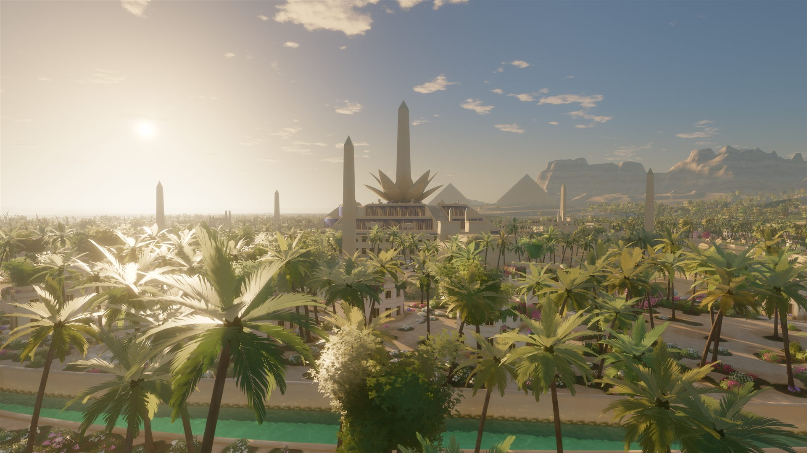
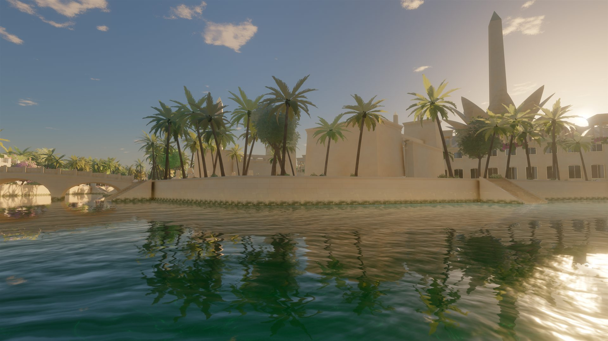
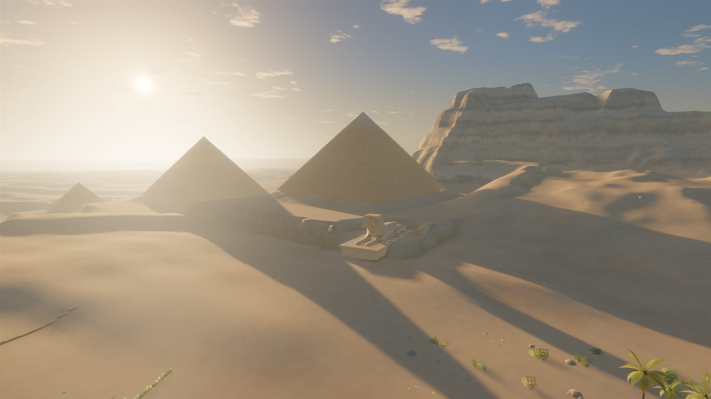
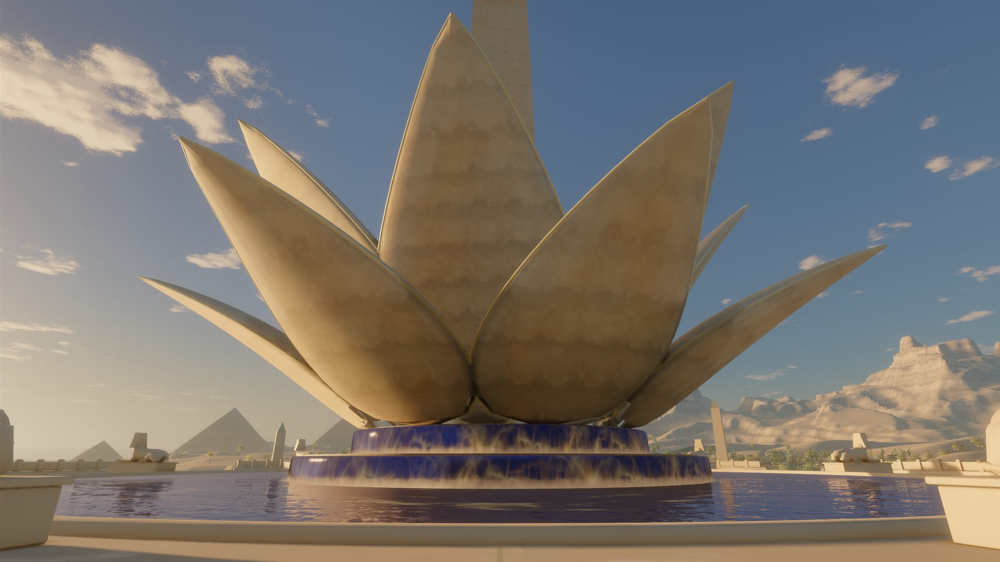
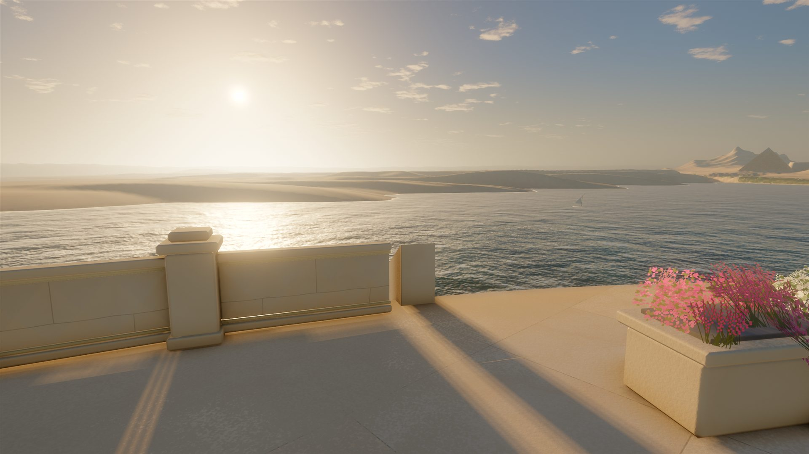
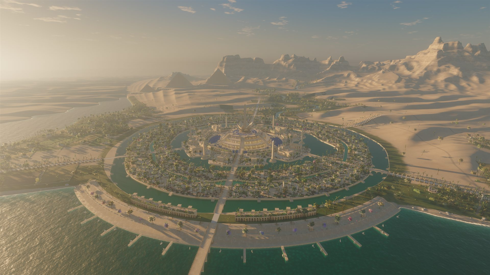

# Luxor

**The lost city of Luxor: a golden sandstone temple city on the Nile, at the edge of a great desert, that you can fly through in your browser.**

Luxor at golden hour: concentric rings of canals around a stepped podium, a 92 m obelisk rising out of a sandstone lotus, six obelisks on their islands, temples with twin-towered pylons and papyrus columns, avenues of sphinxes, houses among date palms, a harbour of feluccas on the Nile, a green strip of fields along the river, and beyond it dunes, the Theban cliffs and three pyramids with a great sphinx. Everything is generated by code when the page opens. There are no images, 3D models, sound files or libraries, and the whole world fits in **one 100 KB HTML file**.

**Fly it now: [alexadrerui.github.io/CELERE-3](https://alexadrerui.github.io/CELERE-3/)**



## Try it

1. Open the [live page](https://alexadrerui.github.io/CELERE-3/), or download [`index.html`](index.html).
2. Open it in **Chrome** or **Edge** on a desktop computer.
3. Wait a few seconds while the city is raised, then press **Enter** and fly.

Nothing to install, and it works offline. It needs a browser with **WebGPU**. If the page can't start, update your browser or switch to Chrome or Edge.

## What's there

- **The great obelisk**, carved with hieroglyphs in sunk relief and capped with electrum, inside a lotus of weathered sandstone
- **A stepped podium** with falls of lapis-blue liquid threaded with gold pouring down every tier, ringed by sphinxes
- **Canals of deep Nile green** that mirror the city, and wind-blown sand lying on the steps and paving of a city half reclaimed by the desert
- **Temples** with battered pylons, flagpoles and obelisks at their gates, and the six spokes laid out as **avenues of sphinxes** under date palms
- **The Nile**, a broad river with feluccas under sail, a far bank of sand, fields and palm groves along the water
- **The desert**: dunes with sharp crests and wind ripples, the bare Theban cliffs, and three stepped pyramids with a great sphinx in its hollow, all under a hazy low sun
- **A calm chiptune soundtrack**, synthesised live in the browser

| | |
|---|---|
|  |  |
|  |  |



## Controls

| | Keyboard & mouse |
|---|---|
| Look around | Move the mouse (click the scene to capture it) |
| Fly | `W` `A` `S` `D` |
| Down / up | `Q` / `E` |
| Fly faster | Hold `Shift` (x8: 100 m/s instead of 12.5) |
| Flying speed | Mouse wheel, from 0.25 to 50 m/s; the middle button resets it to 12.5 |
| Jump to a viewpoint | `1` to `6` |
| Menu | `Esc` releases the mouse and opens the menu |
| Music on / off | `M` (it starts with your first click or key) |
| Collision on / off | `C` |
| Performance stats | `H` |
| Detail level | **Low**, **Medium** or **High** in the menu (reloads the page) |

The ground, the water, quays, bridges (you can fly under their arches), the podium, the great obelisk, the tower obelisks, the temples and the buildings are solid: you glide along them instead of flying into them. Trees, bushes and rocks you can fly through. Press `C` to switch collision off when you want to pass through something.

**On a touchscreen:** hold one finger down to fly forward and slide it to steer. Put a second finger down to go faster. The `≡` button in the corner opens the menu. A phone held upright shows the scene turned on its side, so it is always landscape.

## Detail levels

Every level shows the same city, with the same buildings and the same trees in the same places. What changes is how finely it is built and drawn.

| Level | What it is | Picked on a first visit for |
|---|---|---|
| **High** | The full scene | Computers |
| **Medium** | Smaller shadow maps, coarser trees, rocks and terrain in the distance, cheaper reflections, at most 2560x1440 | Phones with 8 GB of memory |
| **Low** | The canals reflect only the sky, no ambient occlusion, light shafts or reflections on polished stone, coarser trees and terrain, at most 1280x720 | Other phones, computers with 4 GB of memory or less, and computers whose browser runs on Intel graphics built into the processor |

If loading crashes the tab or the graphics driver gives up, the page starts again one level lower. After a few driver resets, Chrome, Edge and Opera turn WebGPU off until the browser restarts, so if the page says the browser offers no graphics card, close every browser window and open it again.

On a laptop with two graphics chips the browser may run on the weaker one. In Windows, go to Settings → System → Display → Graphics, pick your browser and set it to **High performance**. Your browser remembers the level and the resolution the scene settled on.

When frames come slower than 60 a second, the scene lowers its resolution in small steps and raises it again when there is room. This already happens behind the start menu, so most of the tuning is done before you enter.

## How it works

- Everything is drawn with **WebGPU** directly. No game engine or 3D library is used.
- The city plan is a set of functions: ring radii, spokes, terrain height, the river and the farm parcels. Buildings, temples, obelisks, pyramids, sphinxes, palms and bridges are built from a few parametric shapes and drawn as instances, so each kind of mesh is one draw call.
- The sun never moves, so the sky, the large shadow maps and the environment lighting are computed once at load.
- Each frame, a compute pass culls every instance and picks its level of detail. Then come a sun shadow cascade, a mirror view for the canals, deferred lighting with ambient occlusion and light shafts, then water, crystal and glass, temporal anti-aliasing, bloom and AgX tone mapping.
- The music is a 32-bar chiptune loop synthesised with the Web Audio API.
- An NVIDIA Ampere card draws a frame of the scripted flight on High at 2560x1440 in 7.2 ms on average on the GPU (99th percentile 11.3 ms, worst 11.8 ms). The phone figures measured for Atlantis (a Samsung Galaxy A16 ran Low at about 28 fps at 660x378) have not been re-measured for Luxor.

## How it was made

The project was built with Claude Code (Fable 5.2), which wrote all of the code. The prompt that started it is in [`prompt.txt`](prompt.txt). It points to two inputs that are also in this repository:

- [`artstyle.md`](artstyle.md), the art bible: the city plan, materials, vegetation, water, lighting and the six review shots
- [`concept-art/`](concept-art), eight reference images of the city made with ChatGPT (the prompt still calls the folder `concept-arts`)

The prompt also tells Claude how to check its own work: a separate subagent that sees only the art bible, the concept art and the renders reports visual defects, and GPU timing over a scripted 60-second flight measures the frame time.

### From Atlantis to Luxor

Luxor is a transformation of [Atlantis](https://github.com/Noniv/atlantis) by Maksymilian Dendura (MIT), keeping its engine and following the same rules in [`prompt.txt`](prompt.txt): everything procedural in one HTML file, the same performance budget, and the same verification loop (an independent visual critic over the six review shots and the fly-through, plus GPU timing). Section 0 of [`artstyle.md`](artstyle.md) maps every Atlantis element onto its Luxor counterpart; the concept art still shows Atlantis and serves only as the bar for rendering quality.

Known limitations from the last review: some broadleaf hedges and shrubs still read as stippled leaf cards, the electrum caps of the obelisks look dark from the review viewpoints, and the lapis pool on the podium reads as a flat surface.

## Make it your own

The readable source code is in the [`source`](source) folder. To change something and rebuild `index.html` you need [Node.js](https://nodejs.org) 18 or newer:

```bash
cd source
npm install
npm run build
```

This writes a new `index.html` next to this README. `npm run build:readable` writes an unminified version instead, which is easier to debug in the browser's developer tools.

`npm run build:dev` writes a separate `dev.html` with two extra tools: `F` flies the camera along a one-minute path through the whole city, and `B` runs that flight as a benchmark and reports frame and GPU times.

`index.html` is packed: the minified script is deflated and a small loader inflates it when the page opens, which takes a few milliseconds. `node build.mjs --unpacked` skips that step (204 KB).

| File | What's inside |
|---|---|
| [`source/src/layout.js`](source/src/layout.js) | The city plan as functions, the six viewpoints and the fly-through path. **A good place to start.** |
| [`source/src/city.js`](source/src/city.js) | Where everything stands: domes, halls, villas, trees, flowers, the harbour, farmland, the river and falls |
| [`source/src/plants.js`](source/src/plants.js) | Generators for trees, shrubs, vines and hedges, villas, halls, farms and glass domes |
| [`source/src/meshes.js`](source/src/meshes.js) | Generators for the ground rings and quay walls, podium, bridges, terrain and water; obelisks, pyramids, sphinxes and temples |
| [`source/src/world.js`](source/src/world.js) | The mesh registry, plus bridges, balustrades, the great obelisk, the lotus, the plaza sphinxes and the tower obelisks |
| [`source/src/sh_base.js`](source/src/sh_base.js) | Shared shader code, baked textures, the sky and the waves |
| [`source/src/sh_scene.js`](source/src/sh_scene.js) | Culling and levels of detail on the GPU, the opaque materials and shadows |
| [`source/src/sh_light.js`](source/src/sh_light.js) | Ambient occlusion, light shafts, lighting, anti-aliasing and tone mapping |
| [`source/src/sh_fx.js`](source/src/sh_fx.js) | Water, the lapis liquid, crystal, glass and reflections on polished stone |
| [`source/src/collide.js`](source/src/collide.js) | What the camera can't fly into |
| [`source/src/main.js`](source/src/main.js) | The renderer, the camera and the controls |
| [`source/src/music.js`](source/src/music.js) | The music: tempo, key, scale and volume are at the top |
| [`source/src/quality.js`](source/src/quality.js) | The detail levels and every number that depends on them |
| [`source/src/math.js`](source/src/math.js) | Maths, seeded random numbers, noise and the mesh builder |
| [`source/src/dev.js`](source/src/dev.js) | The fly-through and benchmark, only in `dev.html` |
| [`source/template.html`](source/template.html) | The page around the scene: the start menu, loading bar and links |

Some easy first tweaks:

- **The music:** `BPM`, `ROOT`, `SCALE` and `VOLUME` at the top of `music.js`
- **Flying speed:** search for `100 : 12.5` in `main.js` (fast speed : normal speed)

## License

[MIT](LICENSE): free to use, change and share, including in your own projects.
